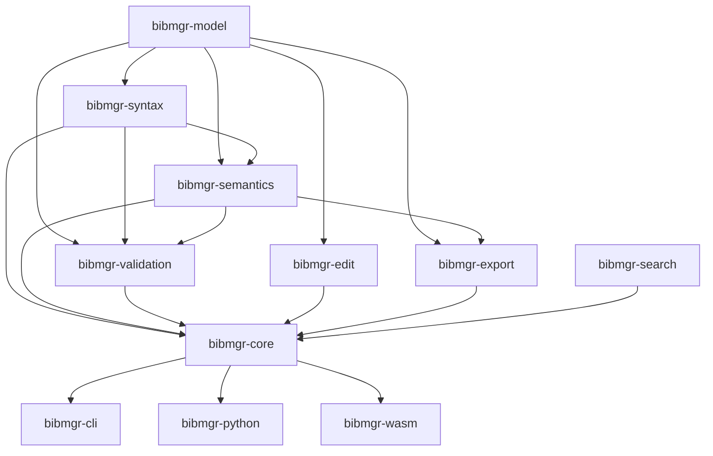
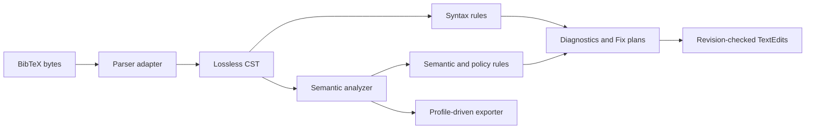

# Architecture

## Scope

The runtime accepts a complete BibTeX document and exposes the same behavior to the CLI, Python backend, Vue application, and WebAssembly consumers. `pipeline/` provides standalone tools for generating an initial bibliography from PDFs.

## Dependency direction

Arrows mean “is used by.” The crate graph is acyclic, and `bibmgr-syntax` encapsulates parser backend types.

The optional `bibmgr-core/search` feature exposes the Tantivy search facade and is enabled by the Python adapter. `bibmgr-search` owns tokenization, BM25 ranking, fuzzy matching, filtering, and stable pagination; Python projects database records and synchronizes committed changes. The CLI does not enable this feature by default.

## Processing model

`bibmgr-core` coordinates parsing, semantic analysis, validation, and revision-checked edits.

## CST and semantic AST

The concrete syntax tree answers “what bytes and spelling did the user write?” It retains trivia, comments, delimiters, casing, concatenation, duplicate fields, malformed fragments, and ranges. Calling `to_source()` on an unedited document returns exactly the original UTF-8 input, including line endings.

The semantic model answers “what bibliography does this represent?” It normalizes domain concepts such as a work type, people, identifiers, venues, and preprints. Every derived value keeps origins, value status, and confidence, including unresolved or conflicting values.

After semantic extraction, `bibmgr-core` resolves venue and repository aliases against the embedded, versioned registries. Resolution adds a canonical venue ID, full/short names, and venue kind, or normalizes a repository archive prefix, without discarding the source text and origin ranges. Registry snapshots are therefore part of the deterministic analysis inputs.

A source range is `[start, end)` in UTF-8 bytes. Line and column values are derived only at presentation time. This is particularly important for edits to Japanese names and other multi-byte text.

## Parser isolation

`bibtex-parser` is an implementation detail of `bibmgr-syntax`. An adapter maps its output into the project-owned lossless syntax facade. The original source, tokens/trivia, ranges, and recovery fragments cover any information not represented by the upstream parser. Higher layers depend only on this facade.

The adapter preserves the original UTF-8 source and exposes consistent byte ranges for ASCII and non-ASCII input.

## Validation and registration

The validation engine receives both CST and semantic bibliography plus a resolved policy. Rule output is sorted deterministically by source range, rule code, and stable diagnostic ID. A diagnostic has two independent dimensions:

- `severity` is how prominently a consumer presents the issue.
- `blocking` is whether the active registration/export policy rejects it.

Registration invokes this engine through `bibmgr-core`. Persistence uses the `archive` policy: strict parser diagnostics remain blocking, while profile conventions, incomplete metadata, and unresolved semantics are advisory. Persistence stores the accepted source exactly as submitted. Callers can request safe CST normalization separately through `canonicalize_for_storage`.

## Fixes and export

A fix is an atomic, ordered set of non-overlapping `TextEdit` values tied to a cryptographic source revision. Application validates the revision and UTF-8 boundaries, applies edits from the end of the document, then re-analyzes the result. Only safe fixes are eligible for unattended application.

Bulk safe fixing may require several atomic plans. The core deterministically selects a non-conflicting batch, applies it, reanalyzes, and plans the next batch against the new revision until reaching a fixed point.

Export serializes the semantic bibliography with a target profile, producing a representation such as `@misc`/`eprint` or `@misc`/`howpublished`. Field projection applies to the generated BibTeX; stored source and semantic records retain their metadata. Ambiguous or conflicting semantics stop export, and the generated representation is revalidated with the profile's target validation policy.

## Adapter boundary

The CLI is responsible for arguments, files, terminal formatting, JSON output, diff display, and exit status. The PyO3 crate converts stable core DTOs to Python objects, maps typed errors, and releases the GIL around CPU-heavy work. The backend handles HTTP, authentication, and transactions. The Vue client renders DTOs and sends selected fix IDs.

The WebAssembly adapter exposes core analysis, safe fixes, registration validation, export, and the profile catalog through a JSON envelope for JavaScript applications. See [WebAssembly API](wasm.md).

All machine consumers use schema version 1. Unknown additive fields should be ignored. A breaking rename, changed meaning, or range convention requires a new schema version.

## Determinism and concurrency

For identical source, resolved policy, and registry snapshots, diagnostics, fixes, registration decisions, and exports are byte-for-byte deterministic. Read-only results are shareable. Multi-file CLI analysis may run documents in parallel, but output preserves input order.

## Failure model

Parser recovery becomes a diagnostic in tolerant mode; strict mode returns an analysis with blocking syntax diagnostics or a typed error where no useful document can be produced. Configuration, stale edits, conflicts, and exports use distinct typed errors, which PyO3 maps to a stable Python exception hierarchy and HTTP maps to structured error DTOs.

## Further reading

- [Public Rust API](api.md)
- [Configuration](configuration.md)
- [Database and reference API](database.md)
- [Authentication and audit](authentication.md)
- [Production operations](operations.md)
- [Rule authoring](adding-rules.md)
- [Venue registry](venues.md)
- [GUI integration](gui-integration.md)
