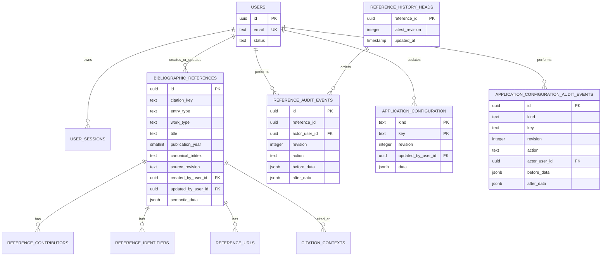

# Database and reference API

## Storage model

PostgreSQL is the source of truth. Stable query and identity fields are relational, the accepted BibTeX entry is stored without profile-driven rewriting as `TEXT`, and the complete semantic record returned by `bibmgr-core` is stored as `JSONB`. The JSONB snapshot retains provenance, confidence, unresolved values, and additive fields without making them the only query representation. The physical text column retains the legacy name `raw_bibtex`, while application code and history DTOs retain the legacy name `canonical_bibtex`; both names now refer to the lossless stored source rather than profile-formatted output.



Contributors are deliberately reference-scoped. Equal author spellings do not prove that two people are the same person, so the initial schema does not create a global person authority record.

## Identity and duplicates

Normalized DOI and arXiv values have a partial unique index across the library. A conflict returns HTTP 409 and rolls back the whole registration batch. ISBN, ISSN, citation key, and title remain searchable but are not global unique constraints:

- an ISSN identifies a venue rather than an article;
- a BibTeX key is normally unique only within a bibliography;
- title equality can produce false positives;
- author name equality does not establish person identity.

Candidate-level title and author duplicate review can be added separately without weakening the strong identifier constraints.

## Search and pagination

Both reference endpoints use a CPU-only Tantivy index for non-empty queries. Search covers title, citation key, contributor names, venue names, identifiers, stored BibTeX, extra fields, and citation contexts. Lindera with an embedded IPADIC dictionary segments Japanese text; English and alphanumeric terms retain their word boundaries and bypass the Japanese segmenter, including in mixed-language text. Unicode width, case, and Latin accents are normalized consistently for documents and queries. All query terms must match, including across fields. For each Japanese run, either its surface terms or its contiguous reading must match; adjacent English and alphanumeric terms remain required. Alphabetic surface terms of 4–32 Unicode characters allow one edit, including transposition, and ASCII terms of at least three characters also support prefix matching. Short acronyms and the identifier field do not receive typo expansion.

Titles, contributor names, and venue names also have a reading index derived from IPADIC. Hiragana, katakana, and half-width kana share a normalized katakana representation, so `しぜんげんごしょり` finds `自然言語処理` and `機会学習` can find `機械学習`. Literal kana are retained rather than reinterpreted through the dictionary. Structured contributor names also expose family-first reading aliases, so `やまだたろう` can find a contributor displayed as `太郎 山田`; these aliases do not change surface ranking or author filters. Unknown kanji retain their surface form; readings of names and specialist terms depend on dictionary coverage. Reading matches do not depend on morphological token boundaries. Readings of 4–32 characters allow one insertion, deletion, substitution, or adjacent transposition; three-character readings allow only a single voicing change such as `モテル` to `モデル`. Shorter and longer readings require exact substring matches in the reading index. Small kana, voicing, and long vowels remain distinct in exact matches.

Reading n-grams select candidates, and a verifier checks contiguous readings before counting, sorting, and pagination. Candidates are never truncated to a fixed top-K list. A contiguous reading match cannot bridge separate contributor or venue values, different fields, or an intervening Latin word. Balanced double quotes require a surface phrase or an exact reading phrase within one field value; reading phrases preserve Latin word boundaries and do not permit typos. Reading expansion does not apply to stored source text, citation contexts, identifiers, or explicit filters.

The default `relevance` order uses field-weighted BM25, with title and contributor matches weighted above source text and citation contexts. Exact identifiers and titles precede other matches. For Japanese queries, surface matches rank before exact readings, which rank before typo matches; BM25 and field weights order results within these tiers, and title phrases receive an additional boost. DOI URLs and `doi:` / `arxiv:` prefixes are accepted in queries. The primary `GET /references/page` endpoint retains `year`, `author`, `venue`, `identifier`, `entry_type`, `created_by`, `updated_from`, `updated_to`, and the explicit date/title sort orders. Filters apply before counting and pagination; the response contains `items`, `total`, `limit`, and `offset`. Every ordering includes a stable UUID tie-breaker, and `limit` is bounded to 100. Queries are limited to 512 Unicode characters; reading edit verification uses fixed-size query state and is disabled above 32 reading characters. Empty queries browse PostgreSQL directly, with `relevance` falling back to most recently updated. Existing `pg_trgm` indexes support those browsing filters.

Each backend process builds a disposable in-memory index on its first non-empty search, then checks a database generation before subsequent searches. Reference transactions update `reference_search_state` and the latest per-reference row in `reference_search_changes` alongside history. The singleton generation row serializes writers until commit, so a transaction that commits later cannot fall behind an index cursor. Deletion markers survive reference deletion. Registration, editing, citation-context changes, deletion, and restoration therefore reach every process on its next search; rolled-back writes do not advance the generation. Native searches pin a reader and its matching metadata generation, so concurrent updates cannot expose partial reading changes. Index failures discard the local projection and return HTTP 503 so the next request can rebuild it. Only the requested result page is loaded from PostgreSQL after retrieval. Native upgrades rebuild this disposable projection when backend processes restart; the reading index requires no database migration.

Run `cargo run --release -p bibmgr-search --example benchmark -- 100000` to measure index construction and warm-query p50/p95 on a synthetic corpus, including English typos, kana queries, Japanese reading typos, mixed queries, and quoted reading phrases. Measure process memory as well as latency when choosing worker counts; dictionary data, surface terms, reading metadata, and n-gram postings all contribute to each process's footprint. Synthetic timings are not a substitute for measurement on the deployed library and hardware.

## Registration transaction

`POST /references` opens a transaction before invoking authoritative strict registration validation with the `archive` policy. Parser failures and a source without bibliographic records are rejected; `LAB-*` conventions are disabled, while incomplete metadata and unresolved semantics remain non-blocking so the database can retain as much supplied information as possible. The backend never invokes `canonicalize_for_storage` during persistence. It stores the submitted entry bytes and uses the semantic result only for searchable relational projections. For a multi-entry document, UTF-8 byte ranges from the semantic records select the corresponding exact entries. Any invalid native result, duplicate strong identifier, or database failure rolls back every entry in the request.

The active registration policy comes from `BIBMGR_REGISTRATION_POLICY`. The persistence request cannot choose a weaker policy.

`POST /references/{id}/citation-contexts` appends contexts without changing stored BibTeX and records the resulting complete state as a `context` history revision.

## Editing and deletion

`PUT /references/{id}` is a complete BibTeX replacement, not a partial metadata update. It accepts exactly one entry, validates it again, and requires the current `source_revision`. This prevents a stale editor from silently overwriting a newer value.

`DELETE /references/{id}` requires the latest source revision in `If-Match`, rejects a stale revision with HTTP 409, and deletes dependent contributor, identifier, URL, and citation-context rows through foreign-key cascades.

All persistence operations require an authenticated user. Creation and update store the current actor on the reference row. Creation, update, citation-context addition, deletion, and restoration advance `reference_history_heads.latest_revision` and append the same numbered `reference_audit_events` row in one transaction.

History snapshot version 2 contains all restorable relational state plus `submitted_bibtex`, `canonical_bibtex`, and the complete semantic snapshot. New revisions place the same exact stored source in both compatibility fields; older revisions may still contain a submitted/canonical pair from the previous storage policy. A delete appends a tombstone whose `after_data` is null while preserving the complete state in `before_data`. Restore accepts both version 2 and legacy version 1 snapshots. Because the history head has no foreign key to the live reference, it remains discoverable after deletion.

`POST /references/{id}/revert` accepts a target revision and the caller's observed head revision. It locks the persistent history head, rejects a stale head with HTTP 409, restores the exact target snapshot under the original reference UUID, and appends a new `restore` revision identifying its source revision. Strong DOI and arXiv uniqueness constraints are checked again, so restoration cannot overwrite a conflicting live reference.

Historical revisions are append-only. PostgreSQL has a trigger that rejects `UPDATE` and `DELETE` on `reference_audit_events`; application code has no history mutation endpoint.

## Application configuration

`application_configuration` stores database overrides for export profiles and venue mappings. A missing row means “use the embedded Rust default,” keeping the service bootable and the standalone tools deterministic without database configuration. Every effective write compares the caller's `expected_revision`, records the authenticated actor, and appends the action plus complete before/after documents to `application_configuration_audit_events` in the same transaction. The first override of a built-in setting records the embedded definition as `before_data`, so its diff contains only values the user actually changed. New actions distinguish custom creation, built-in override, update, built-in-default restoration, and custom deletion; pre-action-tracking rows use the neutral `change` action when their exact meaning cannot be inferred. Data identical to the current override or embedded default is a no-op: it creates neither an override nor an audit revision. A custom deletion has a null `after_data`; restoring a built-in default records the restored embedded document and removes the override row. Audit revision numbers continue across deletion and recreation of the same key, and category-level history queries retain deleted keys. The effective venue registry is validated as one snapshot so duplicate IDs and alias collisions cannot be committed.

## Migrations

Schema changes use Alembic:

```bash
uv run poe db-migrate
uv run poe db-status
```

`uv run poe db-reset` downgrades a local PostgreSQL database to `base` and upgrades it to `head`. It refuses non-local hosts and requires the database name as interactive confirmation. Non-interactive reset additionally requires both `BIBMGR_ENV=development` and `--yes`.

The application never creates or migrates production tables during import or startup.

PostgreSQL migration round trips, `pg_trgm`, strong identifier indexes, partial uniqueness, and the append-only audit trigger are exercised by `backend/tests/test_postgres_integration.py` when `BIBMGR_TEST_POSTGRES_URL` is set. CI supplies a real PostgreSQL 18 service for this test.
