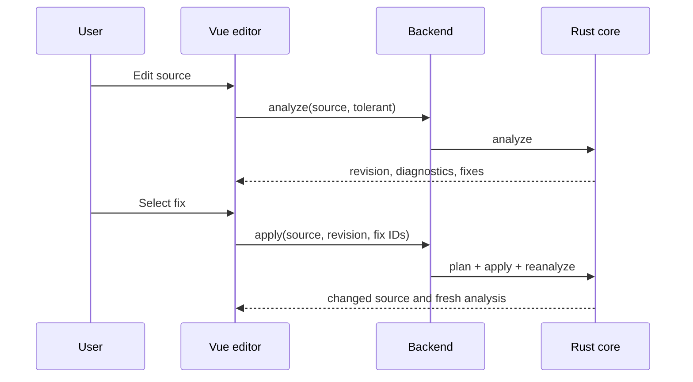

# GUI and backend integration

The web application uses this integration path:

```text
Vue -> Python HTTP API -> bibmgr_native -> bibmgr-core
```

The core produces BibTeX diagnostics and registration decisions. The frontend renders these results and checks input size before sending requests.

## Endpoints

The backend exposes schema-v1 JSON:

| Method and path | Purpose |
| --- | --- |
| `POST /bibtex/analyze` | Strict/tolerant lint and available fixes |
| `POST /bibtex/fixes/apply` | Apply selected revision-bound fix IDs and reanalyze |
| `POST /bibtex/registration/validate` | Authoritative registration decision |
| `POST /bibtex/registration/canonicalize` | Explicit opt-in CST normalization utility |
| `GET /bibtex/export/profiles` | Server-owned output profile catalog |
| `POST /bibtex/export` | Profile-driven semantic export preview |
| `GET /settings/configuration` | Effective export profiles and venue mappings |
| `GET /settings/configuration-history` | Paginated profile or venue history, including deleted settings |
| `POST /settings/export-profiles/preview` | Validate and render an unsaved profile without creating a revision |
| `PUT /settings/export-profiles/{id}` | Add or revision-check an export profile override |
| `DELETE /settings/export-profiles/{id}` | Delete a custom profile or remove a built-in override |
| `PUT /settings/venues/{id}` | Add or revision-check a venue mapping override |
| `DELETE /settings/venues/{id}` | Delete a custom mapping or remove a built-in override |
| `POST /auth/email/start` | Send a passwordless login code |
| `POST /auth/email/verify` | Verify a code and create a session |
| `GET /auth/session` | Restore the current browser session |
| `POST /auth/logout` | Revoke the current session |
| `GET /references` | Search or list persisted references |
| `GET /references/{id}` | Fetch one persisted reference |
| `GET /reference-history` | List histories, including deleted references |
| `GET /references/{id}/history` | Fetch ordered revisions and operators |
| `POST /references` | Atomically validate and register BibTeX |
| `PUT /references/{id}` | Revision-checked replacement |
| `DELETE /references/{id}` | Delete a reference |
| `POST /references/{id}/revert` | Restore a prior state as a new revision |

BibTeX processing, reference reads, configuration reads, and history reads require the HttpOnly session cookie. Reference registration, replacement, deletion, citation-context addition, restoration, and configuration writes additionally require the session-bound `X-CSRF-Token`. The frontend restores that token from `GET /auth/session` and loads the workspace after authentication.

The history catalog retains deleted reference IDs and titles. Each revision derives its before and after BibTeX states from the ordered append-only snapshots and renders a unified line diff with old/new line numbers and highlighted additions and deletions. Creation compares against an empty source, deletion compares against an empty destination, and restoration therefore remains visually explicit. Restoring sends both the selected revision and the currently displayed head revision; `stale_reference_history` means the client must reload rather than retry with an obsolete head.

BibTeX processing requests carry `source`; relevant requests also carry `profile`, `policy`, `mode`, `fix_ids`, or `source_revision`. An explicit fix request must send the revision returned by the analysis that exposed its IDs. Every success carries `schema_version`. Operation failures use a stable code/message DTO. Transport-level request validation uses `invalid_request` without copying framework-owned input values into the response.

## Editor lifecycle



The supplied validation panel debounces real-time tolerant analysis (350 ms by default). A source or profile change cancels the in-flight request and advances a local generation; responses from an older generation are ignored even if transport cancellation races with completion. Fix responses use the same source-generation check.

Render a result only when it belongs to the current editor buffer and profile. Core ranges are UTF-8 bytes, whereas JavaScript string and editor offsets are UTF-16 code units. Convert each primary and related range to UTF-16 before passing it to `slice`, selection, or decoration APIs.

## Diagnostic presentation

Use `severity` for icon/color/order and `blocking` for the registration state. Display related locations and notes when present. The supplied editor decorates both the primary and same-source related locations, using the most severe overlapping diagnostic for presentation. A fix button uses the fix ID and applicability supplied by the backend. The UI must request confirmation for `requires_confirmation` and must not apply `unsafe` automatically.

## Registration

Before persistence, the backend calls `validate_for_registration` with the server-selected `archive` policy. This forces strict parsing, disables `LAB-*` conventions, and leaves incomplete metadata and unresolved semantics non-blocking. The registration and edit UIs run tolerant `archive` analysis for advisory diagnostics and show one read-only output preview generated through the export endpoint. That preview selects `modern` by default and regenerates when the user chooses another profile. Saving sends the current editor bytes directly. Authoritative structural rejection is returned by the persistence endpoint, and the editor keeps its content.

`POST /references` accepts the complete submitted source and stores every exact UTF-8 entry slice plus its semantic projection in one transaction. The response field `reference` contains the first stored record, while `references` contains the complete batch. DOI and arXiv conflicts reject and roll back the complete batch. Each history revision retains the stored source and full semantic snapshot.

`PUT /references/{id}` accepts exactly one entry and requires the current `source_revision`. A mismatch returns `stale_reference` with the current revision, so clients must reload instead of overwriting a concurrent edit.

The reference detail exposes `Edit…` and `Delete…` in the More menu. Editing fetches the latest reference, shows advisory archive diagnostics, and submits the edited source with that `source_revision`. Deletion requires confirmation. Both actions update the selected reference and library list, and deleted items remain restorable from History.

Confirming Sign out calls `POST /auth/logout`.

## BibTeX preview and profiles

The reference detail renders a BibTeX preview from the stored source through the export endpoint, using `modern` by default. Users can select a built-in or custom profile and choose Full or Abbreviated venue names independently. Each response is checked against the current profile, venue style, and source generation before replacing the preview. History displays the persisted value as Stored BibTeX.

Application settings manages shared export profiles and venue mappings. Export profiles use schema-aware controls for field projection, ordering, case protection, renames, formatting, and entry types, with canonical JSON available in the Advanced view. An unsaved draft can be rendered through the preview endpoint before saving.

Deleting a custom setting removes it from the catalog. **Restore Default** removes a built-in setting's shared override and restores the embedded definition. Each write requires the loaded revision; stale responses require a reload, and identical writes leave the revision unchanged. Rust validates profile documents and the complete effective venue registry before persistence.

Category-level history shows each action, actor, time, revision, and unified JSON diff, including deleted custom settings. Diffs compare canonicalized JSON objects and identify empty, deleted, and built-in-default states.

Application controls use Bootstrap Icons through the shared `AppIcon` component.

## Frontend modules

`frontend/src/types/bibtex.ts` mirrors the stable DTO subset, and `frontend/src/api/bibtex.ts` owns transport. Components use these modules to request and display validation results. Requests use the configured API base URL and the authenticated browser session. `frontend/src/utils/bibtexDiagnostics.ts` is the single UTF-8-byte to UTF-16-index conversion boundary used by editor diagnostics.
